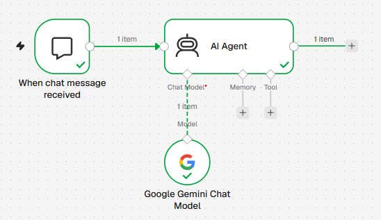
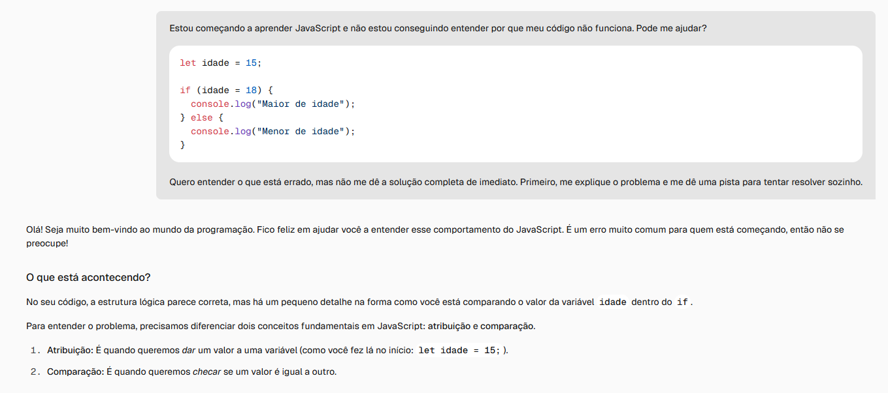
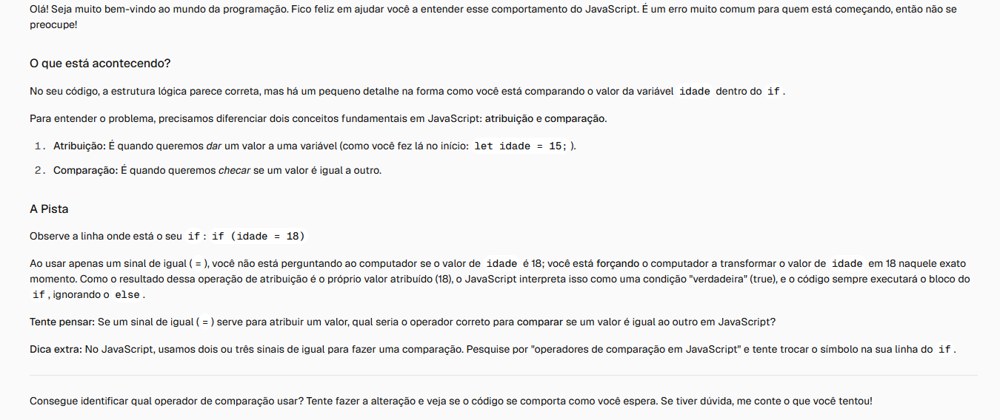

# CodeGuide

Assistente de aprendizagem de JavaScript com inteligência artificial, desenvolvido com n8n e Google Gemini.

## Sobre o projeto

O CodeGuide é um assistente educacional desenvolvido para auxiliar pessoas que estão começando a aprender JavaScript. A proposta é tornar o aprendizado mais acessível por meio de explicações claras, identificação de possíveis erros no código e orientações progressivas para a resolução de problemas.

## Funcionalidades

- Análise de trechos de código JavaScript enviados pelo usuário.
- Identificação de possíveis erros e inconsistências lógicas.
- Explicações adaptadas ao nível de iniciantes.
- Apresentação de pistas progressivas para estimular o raciocínio.
- Sugestões de exercícios para reforçar o aprendizado.

## Tecnologias utilizadas

- **n8n:** construção e integração do fluxo de automação.
- **Google Gemini:** modelo de inteligência artificial responsável pela interpretação das mensagens e geração das respostas.

## Como funciona

O fluxo foi desenvolvido no n8n e possui três componentes principais:

1. **When Chat Message Received:** recebe a mensagem enviada pelo usuário.
2. **AI Agent:** processa a mensagem e orienta a geração da resposta conforme as instruções configuradas.
3. **Google Gemini Chat Model:** fornece o modelo de inteligência artificial utilizado pelo assistente.

### Fluxo de automação

## Demonstração

A seguir, alguns registros das interações realizadas durante os testes manuais do projeto.

### Interação com o assistente

### Pistas progressivas

## Testes

O funcionamento do assistente foi avaliado por meio de cinco testes manuais, envolvendo identificação de erros, análise de lógica condicional, reconhecimento de códigos corretos e orientação por pistas progressivas.

## Limitações conhecidas

O CodeGuide utiliza um modelo de linguagem e, portanto, pode apresentar interpretações imprecisas ou sugestões inadequadas. O sistema não executa os códigos enviados nem verifica seu funcionamento em tempo de execução. Os testes realizados foram manuais e não representam uma avaliação estruturada com usuários.

## Documentação

A documentação completa do projeto está disponível em:

[Documentação do CodeGuide (PDF)](CodeGuide_Documentacao_do_Projeto.pdf)

## Status do projeto

Primeira versão funcional do CodeGuide, com fluxo de automação configurado, integração com Google Gemini e testes manuais realizados.
